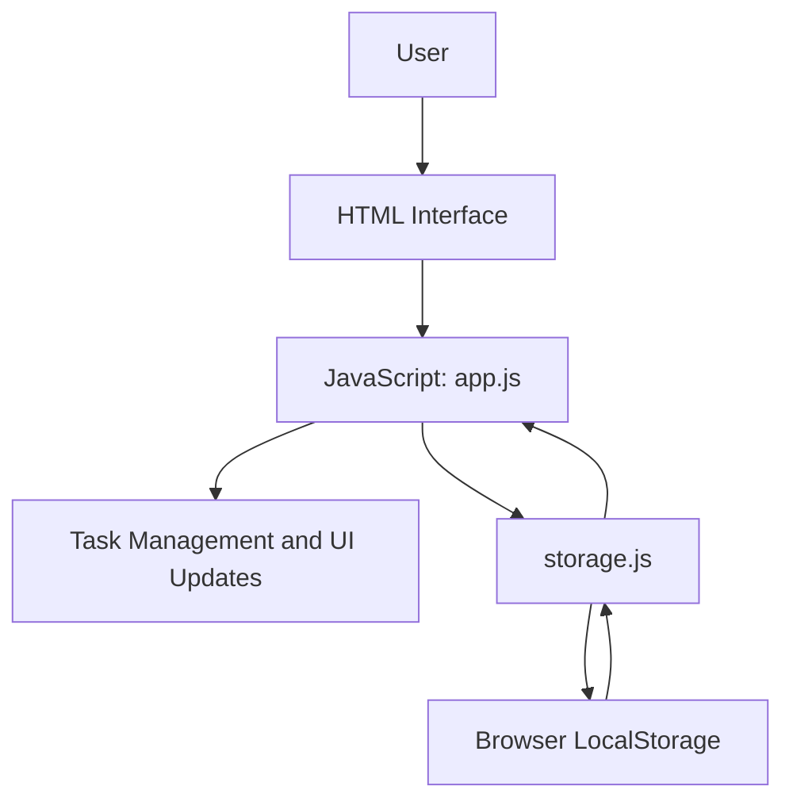

# TaskFlow

TaskFlow is a simple browser-based task management application that helps users organize their work, track task completion, and monitor their progress.

## Features

- Demo login and logout
- Create tasks with a title and description
- View tasks in a dashboard
- Edit existing tasks
- Delete tasks with confirmation
- Mark tasks as completed or pending
- View total, pending, and completed task counts
- Search tasks by title or description
- Filter tasks by status
- Persist tasks and demo session data using browser LocalStorage
- Responsive Midnight Dark theme
- Keyboard focus indicators and accessible task dialog interactions

## Technologies Used

- HTML5
- CSS3
- JavaScript (ES modules)
- Browser LocalStorage

## Project Structure

```text
TaskFlow/
├── index.html
├── style.css
├── README.md
└── js/
    ├── app.js
    └── storage.js
```

## Architecture



### How It Works

- `index.html` provides the login screen, dashboard, task controls, and task dialog.
- `style.css` controls the layout, responsive behavior, and Midnight Dark theme.
- `js/app.js` manages login/logout interactions, task operations, search, filters, statistics, and UI rendering.
- `js/storage.js` handles reading and writing task and user-session data in LocalStorage.

## Getting Started

### Prerequisites

- A modern web browser
- Visual Studio Code
- The Live Server extension for VS Code

### Run Locally

1. Clone or download this repository.
2. Open the project folder in VS Code.
3. Install the Live Server extension if it is not already installed.
4. Right-click `index.html`.
5. Select **Open with Live Server**.
6. Enter a name to access the demo dashboard.

## Data Storage

TaskFlow uses browser LocalStorage to save tasks and the demo user session. Task data persists across page refreshes in the same browser.

Clearing the browser's site data removes the saved application data.

## Authentication Disclaimer

The login functionality is a demonstration only. It simulates a user session using browser LocalStorage and does not provide secure authentication, password verification, or server-side access control. It is not intended for production use with sensitive information.

## Testing Checklist

- [ ] Login and logout work.
- [ ] Tasks can be created, viewed, edited, and deleted.
- [ ] Task completion status can be changed.
- [ ] Dashboard statistics update correctly.
- [ ] Search and status filters work together.
- [ ] Task data persists after refreshing the page.
- [ ] The interface remains usable at smaller screen sizes.
- [ ] No unexpected browser console errors occur.

## Project Status

Core task management features are implemented. Deployment and final submission details will be added after verification.

## Author

Developed as a task management project.
